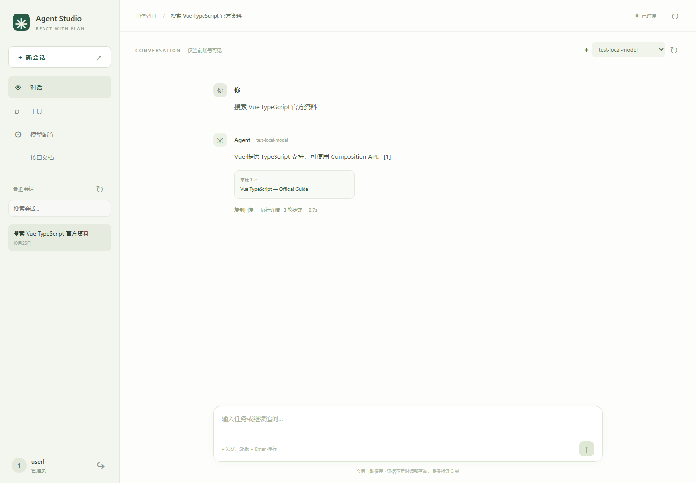

# ReAct with Plan Agent

[简体中文](README.md) | **English**

A domain-neutral local agent framework: Vue 3 + TypeScript/Vite frontend and Python/FastAPI backend. The only registered tool is `web_search`, using keyless DDGS by default or an optional self-hosted SearXNG instance. Connect your own OpenAI-compatible model provider through the UI.



## Local development

Python 3.12 and Node.js 22 LTS are recommended. From the repository root:

```powershell
python -m venv .venv
.venv\Scripts\python.exe -m pip install -r requirements-dev.txt
npm.cmd ci --prefix frontend
Copy-Item .env.example .env
```

Copy the environment template only for a fresh checkout. Preserve an existing `.env` and your saved connection.

Run these commands in two terminals:

```powershell
.\scripts\dev-backend.ps1
```

```powershell
.\scripts\dev-frontend.ps1
```

The scripts prefer `.venv` and also support this workspace's `.python_packages`. If PowerShell blocks scripts, use `powershell -ExecutionPolicy Bypass -File .\scripts\dev-backend.ps1` (likewise for the frontend).

- Frontend with hot reload: http://127.0.0.1:5173/console/
- Backend: http://127.0.0.1:8000
- Swagger: http://127.0.0.1:8000/docs

For a backend on port 8010, set `VITE_API_PROXY_TARGET=http://127.0.0.1:8010` in `frontend/.env` and restart Vite, or build the frontend and open http://127.0.0.1:8010/console/ directly. The backend root is a status endpoint, not the application page.

## Accounts and model connection

| Account | Initial password | Access |
| --- | --- | --- |
| `user1` | `AgentUser1!` | Configure the shared model connection and manage own conversations |
| `user2` | `AgentUser2!` | Select models and manage own conversations |
| `user3` | `AgentUser3!` | Select models and manage own conversations |

Registration is reserved but disabled, including `POST /auth/register`. Set `DEFAULT_USER1_PASSWORD`, `DEFAULT_USER2_PASSWORD`, and `DEFAULT_USER3_PASSWORD` in `.env` **before the first startup** to override initial passwords. Existing accounts are never reset by these variables. Passwords use salted PBKDF2 hashes; login uses server-side sessions and HttpOnly, SameSite=Strict cookies (7 days by default). Logout invalidates the session.

Sign in as user1, open Model configuration, enter the provider URL and API key, fetch its model list, select a default model, then save. The provider must support Chat Completions and `GET /models`. Disable JSON mode if unsupported, although structured responses must still contain valid JSON. Every user can select an available model in the conversation header; per-request selection does not overwrite the shared default.

UI settings are atomically saved to local `data/model-config.json`, override environment settings, and apply to new tasks without restarting. Saved credentials are never returned to the browser or stored in browser storage. Keeping the same provider allows a blank key to reuse the saved key; changing the URL requires a new key. The configuration file and `.env` are ignored by Git. All `VITE_*` variables are public and must never contain secrets.

DDGS requires no dedicated search API key. Search engines may still rate-limit or be unreachable. Set `DDGS_PROXY`/`DDGS_BACKEND`, or configure self-hosted SearXNG; see [search documentation](docs/web-search.md). Search environment changes require restarting the backend.

## Conversations and evidence review

Messages, conversations, selected models, sources, and execution details persist in SQLite. Refreshing, signing in again, or starting a new conversation preserves previous conversations. Search, switch, and delete history in the sidebar.

The backend derives identity from the authenticated session, checks conversation ownership, and loads the last 50 completed messages, bounded to 48,000 characters, from that conversation. Client-supplied user IDs and history are rejected. Failed/interrupted turns are excluded from future context. There is no memory sharing between users or conversations; legacy episodic memory is excluded from chat.

The search flow is: intent → search → evidence sufficiency review → refined search when needed → grounded answer. A successful tool call does not imply adequate evidence. Reviews consider the original question, current context, accumulated sources, and tool results. Search ends early when sufficient, after at most **3 tool calls including failures**, or when no new query is provided. There are no extra hidden search retries. Insufficient evidence produces an explicit limitation; no evidence produces no fabricated answer. If every search attempt fails, the task is marked failed. General conversation uses the model without forcing search. Model evidence judgments can still be wrong, and snippets are not full-page retrieval.

The frontend consumes incremental NDJSON events, batches rendering with animation frames, and follows scrolling only near the bottom. Other conversations can be opened during a run. Concurrent submissions to the same conversation return 409. A disconnected browser does not discard a started turn; refresh recovers its persisted result. Backend restart marks unfinished runs interrupted. Generic DAG execution still blocks dependents of failed steps while independent branches continue, including after a critical failure.

## Build, verify, and documentation

```powershell
npm.cmd run build --prefix frontend
npm.cmd test --prefix frontend
$env:DEBUG="false"
python -m unittest discover -s tests -v
python scripts/export_openapi.py
```

Use `.venv\Scripts\python.exe` if applicable. After building, FastAPI serves `/console/` without Vite. Tests use isolated databases and provider fixtures; no real API credentials or paid calls are required.

| Location | Purpose |
| --- | --- |
| `frontend/src/App.vue`, `MessageBubble.vue` | Login, history, streaming chat, model selection |
| `frontend/src/ModelSettings.vue` | Admin provider configuration |
| `frontend/src/api.ts`, `types.ts` | Typed API client and contracts |
| `agent_system/api/` | Authentication, conversation ownership, chat and configuration APIs |
| `agent_system/core/agent.py` | Bounded evidence review loop |
| `agent_system/core/executor.py` | Generic DAG execution and failure semantics |
| `agent_system/tools/` | Search tool registry and adapters |
| `data/agent.db`, `data/model-config.json` | Local private data, ignored by Git |
| [API](docs/api.md), [OpenAPI](docs/openapi.json) | Backend contracts |
| [Frontend](docs/frontend.md), [Architecture](docs/architecture.md) | UI behavior and runtime boundaries |

This is a single-process local development framework; use one Uvicorn worker because startup recovers interrupted runs. Open registration, password management UI, distributed task queues, departmental SSO/RBAC, and production observability are not implemented. It is not a production internet service. Embeddings, Chroma, and Redis are unnecessary for the default flow. The executor is custom Python rather than LangGraph.

## Concurrency controls (0.4)

The runtime now limits global execution (4 by default) plus an extra 32 in-flight submissions, and per-user execution (1) plus 3 extra submissions. Users are scheduled round-robin. Queue and execution deadlines, cancellation, owner-scoped task status, request deduplication, upstream bulkheads, circuit breakers, bounded streaming buffers, login throttling, and explicit unverified-source degradation are implemented. Defaults and resource bounds are in `.env.example`.

Use `GET /runs/{id}`, `POST /runs/{id}/cancel`, admin-only `GET /operations`, and `GET /ready`. Optional `client_request_id` prevents duplicate execution within a user; duplicates return 409 with the original run ID. Messages load through bounded cursor pagination. Upgrade by stopping old instances, backing up `data`, and restarting one worker; new lifecycle tables are added automatically. A local process lease rejects a second API process sharing that runtime directory.

This remains **single process**, with bounded in-memory scheduling rather than a distributed durable queue. Restart marks unfinished tasks interrupted; it does not resume execution. Database persistence failure is reported rather than hidden. Capacity settings must be tuned against actual provider quotas and measured task duration; concurrency limits are not throughput guarantees.

If persistence fails, the API reports an error and the database run lock may remain. Restore database availability, ensure the old process has stopped, then restart one instance to mark unfinished runs interrupted and release conversations. Execution does not automatically resume after a crash, and results cannot be guaranteed during a database outage. HTTP failures expose stable error codes, request IDs, and Retry-After when applicable; see the [API contract](docs/api.md).
