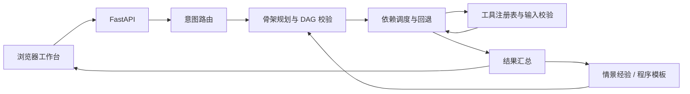

# ReAct with Plan Agent

一个基于 Python / FastAPI 的 Agent 运行框架：先生成计划骨架，再按 DAG 依赖执行工具，结合执行结果完成参数提取和失败回退。自带浏览器调试工作台、前后端接口文档及回归测试。

**项目阶段：可运行的开发原型。业务工具均为 Mock，适合学习、验证编排逻辑和扩展业务能力。真实模型可通过兼容 API 接入；认证、审批与生产级任务恢复尚未实现。**


## 功能

- 语义意图路由与 LLM 兜底，支持从数据库读取启用的意图配置。
- 模板计划与动态骨架规划，规划工具来源于实际注册表，校验 DAG 和工具存在性。
- DAG 分批并行执行，保留参数占位符的列表、字典等原始类型。
- 有限重试、参数修复、已注册备用工具切换和非关键步骤跳过。
- 按分支隔离失败：失败步骤阻塞其后代，独立分支继续，最后汇总整体结果。
- 工具输入 Schema 从 Python 签名生成，执行前进行类型校验，并限制等待时间。
- SQLite 配置与检查点基础组件、Chroma 情景经验、程序模板。
- 对话工作台、意图调试、工具搜索、步骤输入输出和原始 JSON 查看。
- Swagger / ReDoc、可导出的 OpenAPI 协议、前后端接口说明。

前端使用原生 HTML、CSS 和 JavaScript ES Modules，无需 npm 安装或构建。

## 快速开始

建议使用 **Python 3.12**。Node.js 20+ 仅用于运行前端测试。

### Windows PowerShell

```powershell
git clone https://github.com/oopsdud/react-with-plan-agent.git
cd react-with-plan-agent
python -m venv .venv
.\.venv\Scripts\python.exe -m pip install -r requirements-dev.txt
Copy-Item .env.example .env
$env:DEBUG = "false"
.\.venv\Scripts\python.exe -m uvicorn agent_system.api.routes:app --host 127.0.0.1 --port 8000
```

### macOS / Linux

```bash
git clone https://github.com/oopsdud/react-with-plan-agent.git
cd react-with-plan-agent
python3 -m venv .venv
.venv/bin/python -m pip install -r requirements-dev.txt
cp .env.example .env
DEBUG=false .venv/bin/python -m uvicorn agent_system.api.routes:app --host 127.0.0.1 --port 8000
```

仅运行服务时，可以安装 `agent_system/requirements.txt`。本地已有 `.python_packages` 的开发环境也可继续使用，参见 [后端接口文档](docs/backend-api.md)。

启动后打开：

| 地址 | 用途 |
| --- | --- |
| http://127.0.0.1:8000/console/ | 前端工作台 |
| http://127.0.0.1:8000/docs | Swagger 接口调试 |
| http://127.0.0.1:8000/redoc | ReDoc 接口参考 |
| http://127.0.0.1:8000/openapi.json | 实时 OpenAPI |
| http://127.0.0.1:8000/health | 进程存活检查 |

首次启动会创建 SQLite 所需目录和数据表。请从仓库根目录运行，数据库与 Chroma 路径默认相对于工作目录。仓库不包含运行数据库、向量索引、依赖缓存或真实密钥。

`.env.example` 显式开启 Mock 模型和 Mock Embedding，无需 API Key 或下载模型即可检查接口和编排流程。**Mock 不理解自然语言，可能返回占位结果或任务失败，这是调试模式的能力边界。**

## 接入真实模型

修改本地 `.env`：

```dotenv
LLM_PROVIDER=openai
LLM_API_KEY=替换为本地密钥
LLM_MODEL=替换为供应商支持的模型名
# 兼容服务可自行配置：
# LLM_BASE_URL=https://your-provider.example/v1

EMBEDDING_PROVIDER=api
EMBEDDING_API_KEY=替换为本地密钥
EMBEDDING_MODEL=替换为供应商支持的向量模型名
# EMBEDDING_BASE_URL=https://your-provider.example/v1
```

模型服务需要支持当前客户端使用的 JSON 输出模式。也可设置 `EMBEDDING_PROVIDER=local` 并另行安装 `sentence-transformers`，配置本地模型。更换 Embedding 模型后，应使用新的 Chroma 目录或重建向量索引，避免不同维度或语义空间混用。

缺少 LLM Key 或本地 Embedding 加载失败时可能回退 Mock；工作台会显示 LLM 模式，Embedding 展示的是配置值。模型密钥只放在后端环境或 `.env` 中。

## 架构与执行规则



例如计划包含 `A → B` 和 `C → D` 两条分支：A 失败时 B 跳过，C 与 D 继续执行。若 A 或受阻的 B 为关键步骤，所有独立分支结束后任务整体报告失败，返回结果仍保留 C、D 的成功记录。

`is_critical` 控制整体结果判定。依赖关系控制能否继续执行；非关键步骤被跳过，也不能让依赖它的数据消费者继续运行。

参数引用支持 `{{slots.person}}`、`{{steps.1.result.user_ids}}` 和 `{{steps.1.result}}`。完整占位符保留原始对象；混合文本做字符串替换，未解析引用会导致该步骤失败。

经验记忆不可用时降级运行，不会把已经成功的业务动作改报为失败。权限错误不会触发备用通道切换。备用工具必须实际注册，当前默认注册表没有通知备用通道。

## 项目结构

```text
agent_system/
  api/                 HTTP 路由与请求响应模型
  config/              环境配置
  core/                Agent、意图路由、规划与执行器
  tools/               工具定义、Schema 和注册表
  memory/              工作、情景、程序记忆
  db/                  数据模型和连接管理
  utils/               LLM / Embedding 客户端
frontend/              浏览器工作台和 API 客户端
docs/                  接口文档、OpenAPI 和审核记录
scripts/               协议导出脚本
tests/                 Python 回归与前端客户端测试
.github/workflows/     自动检查
.env.example           无密钥配置示例
```

根目录中的中文设计文档保留了方案背景，可能包含尚未实现的目标。实际能力以代码、测试和本 README 为准。

## 接口文档

- [后端 HTTP API](docs/backend-api.md)
- [前端 JavaScript API 与交互约定](docs/frontend-api.md)
- [OpenAPI 协议快照](docs/openapi.json)
- [本次审核与修复记录](docs/review.md)

后端主要接口：`GET /health`、`GET /runtime`、`POST /chat`、`POST /intent`、`GET /tools`、`GET /tools/{tool_name}`。根路径 `/` 保留 JSON 服务信息，前端位于 `/console/`。

`/chat` 是非流式接口。HTTP 200 不代表业务成功：调用方需要检查 `success`、`error` 和 `steps[].status`。前端超时只停止等待，不能保证后端停止或回滚；写入任务状态不明时应先核实结果。

## 扩展一个工具

继承 `BaseTool`，为 `_run` 的参数添加类型注解，再注册到工具表。参数 Schema 由签名生成，Planner 从注册表读取允许的工具名。

```python
from agent_system.tools.registry import BaseTool, get_tool_registry

class LookupOrder(BaseTool):
    def __init__(self):
        super().__init__("lookup_order", "查询订单")

    async def _run(self, order_id: str):
        return {"order_id": order_id, "status": "example"}

get_tool_registry().register(LookupOrder())
```

请在创建 Agent 之前完成注册。连接真实业务后，应为有副作用的工具补充权限检查、幂等与审计，并按具体工具定制重试策略。

## 验证

安装 `requirements-dev.txt`，设置 `DEBUG=false`、`LLM_PROVIDER=mock`、`EMBEDDING_PROVIDER=mock` 后执行：

```text
python -m unittest discover -s tests -v
node --test tests/frontend-api.test.mjs
node --check frontend/app.mjs
python scripts/export_openapi.py
```

Windows 虚拟环境可将 `python` 替换为 `.\.venv\Scripts\python.exe`；macOS / Linux 使用 `.venv/bin/python`。

测试覆盖分支隔离、关键步骤汇总、参数类型、无效计划、重试、工具超时、通知链路、记忆降级、首次数据库初始化、静态资源和 API 契约。GitHub Actions 使用 Mock，不调用真实模型或发送通知。

## 当前限制

- 无登录、租户鉴权、工具审批和请求限流；`user_id` 仅是调试标识。建议仅绑定本机地址运行。
- 所有内置业务工具为 Mock；知识检索、文档入库和提醒投递尚未连接真实系统。
- 多意图目前只识别并返回字段，尚未拆分为完整子任务 DAG。
- 工作记忆有持久化组件，但主执行链路尚无逐步检查点和恢复 API。
- 情景记忆的 TTL 清理、容量限制和并发计数一致性尚未完成。
- 尚无队列 Worker、流式输出、取消任务、幂等保障与持久化审计链路。
- 语义路由命中模板时，槽位不全会安全失败；尚无完整多轮追问机制。
- 同步工具在线程池中运行，超时停止等待，无法强制终止底层操作。
- 依赖尚未形成跨平台锁文件；本次本地验证环境为 Windows / Python 3.12 / Node 20，其他环境由 CI 和后续验证补充。
